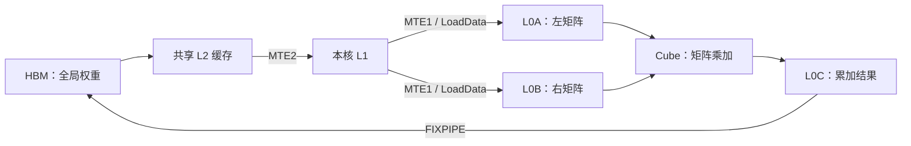

# 从本次降维矩阵乘理解数据搬运

整理日期：2026-10-19，Asia/Shanghai。本文是已有证据的技术说明与地址推导，没有新增上板实验，也没有继续修改内核。

## 计算对象与数据量

当前 MTP 每轮处理两个位置，降维计算为 `Y[2,5120] = X[2,17408] × W[5120,17408]^T`。BF16 下，逻辑数据量如下：

| 数据 | 字节数 | 十进制近似 |
|---|---:|---:|
| 输入 X | 69632 | 69.6 KB |
| 权重 W | 178257920 | 178.3 MB |
| 输出 Y | 20480 | 20.5 KB |

权重读取是主负担。若仅计一次权重读取，FLOPs/权重字节数为 `2MNK / (2NK) = M`；这只是算术强度估算，不是 HBM 计数或性能测量。

## 数据经过哪些存储与流水

下图描述本次常规矩阵乘的主要数据路径。GM 是逻辑全局内存空间；L2 命中可以减少 HBM 访问，图中箭头不意味着每次读都必须访问 HBM。



L1、L0A/L0B/L0C 的内容由程序显式安排，不能一概理解为 CPU 那种自动替换的缓存。MTE2 搬入数据，MTE1 通过 LoadData 送入矩阵引擎所需的局部布局；L0C 可跨 K 分块继续累加，最终由 FIXPIPE 输出。本例输出为 BF16/ND；融合算子可能有其他输出路径。

通路职责参考 [Ascend/msinsight 官方分析说明](https://github.com/Ascend/msinsight/blob/master/docs/zh/best_practices/Operator_Fusion_Analysis.md)。

## 分块：哪些来自旧内核解析，哪些只是推导

此前解析的 **M=1、ND 降维内核**使用 23 核。大多数核负责 224 个输出，分成两组各 112 个；K=17408 分为 34 块，每块 512。该记录见[原始搬运分解](../evidence/2026-10-19/down-movement.json)。这些是旧形状的已验证参数，不能直接宣称当前 M=2 NZ 路径全部采用相同运行时 TilingData。

下面取一个起点按 16 对齐的 `112×512` 权重子块，只推导地址分布。有效数据量为 `112×512×2 = 114688 B = 112 KiB`。

### ND 地址分布

按行存储的 W[N,K]，元素地址为：

```text
addr(n,k) = base + 2 × (n × K + k)
```

当 K=17408，每行目标片段为 1024 B，相邻源行起点相隔 34816 B，因此目标片段之间间隔 33792 B。从地址看，是 112 段各 1024 B 的数据。

二维搬运可以一次描述行数、列数和源行跨度，并非 112 次 CPU memcpy。针对该源视图，Nd2NzParams 的 `nValue=112`、`dValue=512`、`srcDValue=17408` 分别描述行数、列数和源行起点跨度；`srcDValue` 的单位是元素，其他搬运重载的 stride 单位可能不同，必须按实际接口核对。

GM→L1 可以伴随 ND→NZ 转换，参考 [CANN ND2NZ 搬运接口](https://www.hiascend.com/document/detail/en/CANNCommunityEdition/910/API/ascendcopapi/docs/en/api/SIMD-API/basic_api/cube_compute_ISASI/cube_compute_load/DataCopy_GMToL1_ND2NZ.md)。

### NZ 地址分布

本次对齐 BF16 权重按 `16×16` 小块排列，每块 512 B。W[5120,17408] 的导出物理形状为 `[1088,320,16,16]`，逻辑形状不变。参考 [官方分形格式说明](https://www.hiascend.com/doc_center/source/en/CANNCommunityEdition/850/opdevg/Ascendcopdevg/atlas_ascendc_10_0099.html)。

对本次不需要 padding 的维度，可将地址写为：

```text
k1 = k // 16; n1 = n // 16
n0 = n % 16;  k0 = k % 16
element_offset = (((k1 × 320 + n1) × 16 + n0) × 16 + k0)
addr(n,k) = base + 2 × element_offset
```

同一个 `112×512` 子块覆盖 7 个 N 小块、32 个 K 小块。固定一个 K 小块时，7 个 N 小块连续占 3584 B；相邻 K 小块组的起点相隔 163840 B。从地址看，是 32 组各 3584 B 的数据，有效总量仍为 112 KiB。

**112 段与 32 组是存储地址分组推导，不是测得的 DMA 指令数或 HBM 事务数。** 硬件可以进一步合并、拆分请求；源地址分布也不能单独证明 NZ 更快。当前尚未证明这种地址分布就是整模型 NZ 退化的根因。

## 双缓冲与依赖

L1 与 L0 可以分别使用双缓冲。核心思想是计算当前块时准备下一块，而不是让所有阶段串行相加。

| 依赖方向 | 必须满足的条件 |
|---|---|
| MTE2 → MTE1 | L1 数据已写好，可以读取 |
| MTE1 → MTE2 | 对应 L1 数据已取走，可以覆盖 |
| MTE1 → Cube | L0A/L0B 已准备好，可以计算 |
| Cube → MTE1 | 对应 L0 数据已使用完，可以覆盖 |

SET_FLAG/WAIT_FLAG 管理这些生产者和消费者关系，包括数据就绪与缓冲归还。等待长时需沿依赖向上游查，不能通过删除等待来修复搬运瓶颈。参考 [官方同步机制](https://www.hiascend.com/doc_center/source/zh/canncommercial/800/developmentguide/opdevg/Ascendcopdevg/atlas_ascendc_10_0011.html)。

之前的输入搬运 68→34 次，属于复用同一段 L1 输入来服务两组输出，不等于整块权重读取减半；自写内核路线已停止。

## 读懂 Insight 的字节与时间

必须分清逻辑数据量、分块缓冲容量、搬运事务计数三个口径。此前“多 21.5625%”包含 L1 清零和 ND→NZ 写请求，并不是多读了相同比例的 HBM 权重。DataBlock、分形块、L2 cache line 和缓冲大小也不是同一单位。

不同流水可以重叠；MTE2 活动占比不是带宽峰值利用率，活动时间不能与 MAC 时间直接相加得到算子耗时。当前 NZ 同卡对比中，升维 MTE2 活动时间 232.815→282.883 μs，MAC 两边约 31.799 μs，差额已定位到读取/搬运环节；具体的事务或运行时参数原因仍未确认。

L2 干预和同地址真实权重实验没有支持两个简单解释。完整数据、失败采集与结论边界见 [NZ 差异补采报告](../experiments/nz-context/README.md)。

推荐按一个固定子块依次记录：源地址 → 搬运描述符 → L1 布局 → L0 装载 → MMAD → 缓冲归还，并把每一步和 Insight 的对应流水对照。
