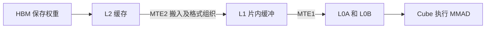

# Qwen3.8-27B 在 Ascend 910B2 上的性能定位与优化复盘

整理日期：2026-10-21。实验主要发生于2026-10-16、19、20日，事件时间统一为Asia/Shanghai。

这次调优从单卡约6 token/s开始，先解决主机下发开销，再用投机解码减少主模型反复读取权重的次数，最后深入到矩阵乘的搬运和分块。已经验证的大幅收益来自图模式与MTP配置；最新的原生分块实验只缩短了降维算子的局部耗时，整模型基本持平。

这份复盘面向第一次接触推理调优的读者。每一步都说明当时看到的现象、为什么提出某种假设、怎样控制变量、工具实际返回了什么，以及据此采用或放弃了什么方案。失败实验和结论更正也是过程的一部分。

## 阅读顺序和测量口径

全文分成四段：

1. 第一步至第四步：建立环境，用图模式解决下发开销，定位前馈矩阵乘和21.6%的计数差额。
2. 第五步至第八步：自写内核尝试、MTP、NZ布局，以及跨层TLB退化的定位。
3. 第九步至第十二步：DFlash2与框架对照、MTP7、128题验证，以及当前ND/M8的大页和搬运检查。
4. 第十三步至第十六步：修复采样解析、定位HBM供数、核对原生分块、解释最后4%与0.47%的关系。

先区分四种结果，后面的数字才不会混淆：

| 结果类型 | 它回答的问题 | 本次如何使用 |
|---|---|---|
| 无profiler的完整模型测速 | 用户真正等了多久、生成多快 | 判断是否获得端到端收益 |
| 框架profiler和Insight时间线 | 哪些模型阶段、算子、等待占时间 | 定位热点、核对主模型和草稿的执行次数 |
| 原生单算子上板采样 | 一个固定形状的算子内部发生了什么 | 查看流水活动、内存请求、缓存及TLB事件 |
| 原生二进制仿真 | 实际执行哪些搬运、清零和乘加指令 | 检查指令、地址和分块；仿真时间不当作硬件实测速率 |

早期速度采用流式返回的连续生成速度，后来的GSM8K采用包含输入处理的整段评测吞吐。它们可以展示调优阶段的变化，但不能直接拼成一条严格可比的加速曲线。只有条件对齐的阶段内部A/B才用于计算收益。

目标始终围绕单用户推理，后期明确保持BF16权重，不通过量化减少位宽。多人同时请求的大批量虽然能摊薄权重读取，却不是单人会话的直接优化。双卡曾单独测试，后续最佳配置回到单卡；两者成绩分别记录。各次实验使用个人环境与获分配的卡，不改其他账号、共享CANN或驱动。

## 第一步 建立环境并确认采集链路有效

### 我们先解决什么问题

最初需要区分MindStudio IDE与Insight：前者是开发界面，后者用于查看性能采样。后续重点使用Insight，既能看时间线，也能直接调用开源编译版后端读取结构化结果。

本机准备了Git、Python和编辑器，克隆Insight源码与quick-start-demo。先导入示例，学习MMAD、SET_FLAG、WAIT_FLAG和各流水单元的含义。这里没有修改模型，也没有获得模型加速。

接入服务器后确认硬件为8张Ascend910B2，标称每卡64GiB HBM；个人运行环境位于自己的目录，后续使用CANN9.1.0。实际运行时可见容量曾查询为约60.957GiB，不能把标称64GiB直接当作框架可用容量。

### 为什么先跑小例子

2026-10-16先在6号卡运行64×64的FP32矩阵乘加法，检查输出误差，采到6个计算kernel，累计约20.88μs，并成功导入Insight。

这一步把“环境是否可用”与“大模型是否优化好”分开：小例子通过，只能说明计算、采集、解析和导入的链路打通。

随后运行BF16的Qwen3.5-9B，采集16个输出token。无采样约11.35 token/s，开启采样约9.07 token/s。这个差异提醒我们：**profiler会扰动性能，不能拿采样中的速度替代正式测速。** 27B先完成文件与配置校验，之后才进入上板推理。

依据：[环境与首轮采样日志](../journal/2026-10-16.md)、[早期准备记录](../journal/undated-history.md)。

## 第二步 从约6 token每秒追到主机下发开销

### 现象和第一个假设

2026-10-19实际调优对象改为仓库记录中的Qwen3.8-27B Dense模型，采用单卡TP1、BF16、单并发、上下文4096、关闭前缀缓存。最初运行Eager模式，26个输入token、64个输出token，无profiler重复3次，连续生成速度中位数约5.545 token/s。

Eager意味着模型执行时逐步下发操作。时间线上看到较多设备任务间隙，因此提出假设：主机准备、下发和调度让设备等了很久。

### 我们怎样验证

保留同一卡、模型、BF16及请求，切换主模型为`FULL_DECODE_ONLY`，捕获大小为1的解码图。图模式提前记录一串设备操作，后续重放这串操作，减少逐个操作的重复下发。

先做3次无profiler测速，再单独采样；同时检查两侧前64个输出token是否一致。

| 指标 | Eager | 图模式 |
|---|---:|---:|
| 连续生成速度中位数 | 5.545 token/s | 20.280 token/s |
| 首token等待中位数 | 0.536s | 0.388s |
| 本次3组输出检查 | 参考 | token序列全部一致 |

速度为原来的约3.66倍，因此图模式是第一次明确有效的优化。

### 为什么切完图还要重新定位

原来“设备经常等下发”不代表切图后仍然如此。我们用15个硬件`MODEL_EXECUTE`标记划出连续解码区间，避免把Prefill输入处理混在里面，再合并设备计算任务区间。

结果是：746.58ms的解码窗口里，计算任务覆盖约737.05ms，无计算任务区间仅约1.28%；矩阵乘累计约633.66ms，占窗口84.9%。主要矛盾已经转移到设备执行的算子。

任务覆盖率高只说明设备任务连续，不能据此说乘加单元或显存带宽达到峰值。

依据：[Eager与图模式对照](../evidence/2026-10-19/eager-vs-graph.json)、[解码区间划分](../evidence/2026-10-19/graph-phases.json)。

## 第三步 从矩阵乘热点定位到权重读取

### 先找出是哪两组矩阵

通过编译版Insight的`operator/statistic`与明细接口，按算子形状统计，再根据64层结构核对调用次数。早期M=1时，目标前馈网络FFN的两组操作为：

| 操作 | 输入与权重形状 | 当时单次均值 |
|---|---|---:|
| 门控加升维投影 | `[1,5120]`与`[34816,5120]` | 282.67μs |
| 降维投影 | `[1,17408]`与`[5120,17408]` | 151.97μs |

各出现960次，即64层×15个解码步骤，两组累计占当时连续解码窗口约55.9%。这让后续工作从“所有算子都可能慢”收敛到两组具体矩阵乘。

升维输出34816包含门控和升维的组合投影；激活后的中间宽度为17408，再由降维投影回5120。

### 为什么小矩阵乘也要读大权重

线性层可以写成`Y=XWᵀ`。单用户逐token解码时，X的行数M很小，但W仍然很大。两份BF16权重的逻辑大小分别是340MiB和170MiB，64层合计：

```text
64 × (34816 × 5120 + 5120 × 17408) × 2字节
= 34,225,520,640字节
≈ 34.23GB = 31.875GiB
```

这是早期每个主模型解码步骤需要遍历的这两组逻辑权重大小，不等于所有模型权重，也不是逐token直接采到的物理HBM事务数。引入MTP后，同一轮读取会服务多个候选位置，“每个主模型步骤”更不能继续等同于“每个最终输出token”。

### 证据怎样逐层补齐

第一层证据是时间：两组矩阵乘占据热点。

第二层证据是流水：MTE2搬运活动占比高，MAC乘加活动占比较低。MTE2负责GM经缓存到L1的数据搬运，MAC负责矩阵乘加。它们可以重叠，因此99%的搬运活动与十几个百分点的乘加活动不能相加，也不能把99%解释成99%的硬件峰值带宽。

第三层证据是字节与带宽：同形状原生算子补采显示外部读取接近一遍权重加输入，没有权重被反复读取多遍的证据；独立系统采集显示当时稳定生成HBM读速率约1.046TB/s。工具原字段按1024²换算，我们先核对单位，再换成十进制TB/s。

这时可判断“权重读取与搬运是主要研究方向”，但还不能分清HBM供数、缓存、格式转换和片内写入各自的限制。后面几步就是继续把这条链拆清楚。

依据：[两组矩阵乘](../evidence/2026-10-19/two-matmuls.json)、[HBM系统采集](../evidence/2026-10-19/hbm.json)。

## 第四步 校准降维多出的搬运计数

### 异常为什么值得追

降维权重为178257920B，工具`GM_to_L1_datas`却给出216694784B，高出21.5625%。最初问题是：这些额外字节是否意味着显存重复读，能否删除？

不能只凭字段名回答。我们定向捕获原生MatMul二进制、160B TilingData和输入。上板TimelineDetail返回107001，没有有效设备指令时序，于是保留原23核分配，使用捕获的原二进制和参数做仿真，再用Insight动态指令接口核对core0。

仿真显示：K分34块，每块512元素；输入搬入68次、权重搬入68次，另有68次`SET_2D`清零。输入是同一批K块被两个输出子块各读一遍，权重则是不同输出列的不同数据。

### 用最小探针校准字段含义

我们分别运行“只清零”和“只执行一行ND2NZ搬运”的探针，上板采集并读取后端：

- 一次原地清零16KiB，也会计入这个`GM→L1`字段。
- 一次有效输入仅1KiB的ND2NZ，在这个口径下计入8KiB写请求。

把23核的记录重新相加，得到：

| 来源 | 合计字节 | 相对权重 |
|---|---:|---:|
| 权重 | 178257920 | 100% |
| L1清零 | 25624576 | 14.375% |
| 输入ND2NZ写请求 | 12812288 | 7.1875% |
| 工具字段总计 | 216694784 | 121.5625% |

四项精确闭合。因此21.6%并不是HBM额外读了21.6%的权重，也不等于能让算子快21.6%。其中包含清零和特定布局的写请求粒度。

### 由证据形成的优化方案

输入只读，两个输出子块都需要它。于是提出：两个L1输入缓冲各初始化一次，将清零68→2；每搬一个K块先用于两个输出子块，将输入搬运68→34。权重仍要搬68次，因为两组输出使用不同权重列。

这是一个具体的循环重排与缓冲复用方案，需要修改内核，不能靠vLLM的普通开关完成。此时只有布局推演和计数校准，还没有可用的模型加速结果。

依据：[计数校准](../evidence/2026-10-19/calibration.json)、[23核字节闭合](../evidence/2026-10-19/down-movement.json)、[原生指令返回](../evidence/2026-10-19/backend-instruction-focus.json)。

## 第五步 自写内核的收益与数值问题怎样被发现

### 先做独立算子 再接模型

在固定BF16形状下实现自写基线、清零前移、输入复用、输入复用加双缓冲四个版本。只改实验目录，保留原CANN作参考。复用版单独运行约152μs，与原生基本持平；流水显示仍有搬运和计算串行等待，因此增加预取双缓冲。

正式无profiler基准采用4份不同权重、图回放、40轮正反顺序交替，避免单次Python调用混入提交时间：CANN中位154.510μs，自写双缓冲142.415μs，耗时减少7.828%。

但部分BF16输出与原生相差一档。BF16保持不变，只代表没有改变数据位宽，不保证浮点累加顺序和最终输出逐位相同。

### 集成时先证明替换实际发生

第一次仅替换Python linear方法，编译后的模型绕过了该方法，提交计数为0，Insight仍看到原CANN。这个阶段被判为无效集成，不能拿模型速度变化当作自写内核的收益。

随后接入实际GEMM dispatch，在当前NPU stream上通过Torch NPU封装提交，支持异步和图捕获。真正生效的实验中，Insight看到降维内核960次，均值约141.260μs；原生约151.860μs。

模型生成速度观察到20.298→20.443 token/s，但有提示从第98个token开始不同，另一翻译检查也不同，因此这个方案没有通过模型输出校验，没有部署默认。

### 为什么小误差最终会改掉回答

继续解析全部23核后发现，原CANN并非所有核都从K0递增累加，各核使用不同K块遍历顺序。早期只看core0，将其规律推广到全核，是错误假设。

按原生各核顺序修正后，25个输入案例、4个版本共512000个输出比较与CANN逐位一致；异步提交、图捕获和输入变更依赖检查也通过。

修正后的完整模型验证尚未完成时，你要求停止重新写内核。于是停止这条路线，保留代码与证据。旧版7.83%的独立算子收益没有移用到修正版，更没有记成模型加速成绩。

这个阶段留下两条重要检查顺序：先证明新路径真正被调用，再验证数值和整模型；单算子速度只是其中一环。

依据：[独立内核实验](../kernels/down-reuse/README.md)、[模型A/B及输出失败](../evidence/2026-10-19/down-model-ab.json)、[K顺序修正验证](../evidence/2026-10-19/down-korder-validation.json)。

## 第六步 用MTP摊薄每次权重读取的成本

### 为什么从改内核转向投机解码

前面的证据说明，主模型每轮都要读取大权重。如果不量化、不改变权重数值，另一个方向是让同一轮读取服务更多有效输出token。

MTP先起草候选，再由主模型验证。候选通过才被接受，未通过的部分丢弃；草稿本身也消耗计算和读取。它不是省掉主模型的验证，而是把多个待验证位置放进同一轮，使大权重的成本被多个位置分摊。

这与KV Cache复用不同：KV Cache保存历史注意力的Key和Value，主要避免重复处理历史；FFN的大权重仍然要参与每一轮前向。两者可以同时存在。

### 单候选MTP的同条件对照

保留原CANN、BF16和单卡，启用一个MTP候选，主图捕获大小从1变2。两个提示各重复4次，固定128输出token、关闭profiler，再做输出检查。

| 指标 | 不启用MTP | 单候选MTP |
|---|---:|---:|
| 连续生成中位速度 | 20.249 token/s | 31.136 token/s |
| 128token整请求中位时间 | 6.645s | 4.459s |
| 所测输出检查 | 参考 | 8次测速及3次额外检查一致 |

### Insight怎样证明加速机制

另采同样32token请求：主模型验证31→17轮，矩阵M=1→2；升维、降维单次时间仍接近原来，但两组FFN累计861.437→485.547ms。

基线每组1984次=64层×31轮；MTP每组1105次=65层×17轮，其中包含一个草稿层。没有把草稿层算成主模型多了一层。

因此这次收益来自执行轮数减少，而不是每次矩阵乘突然更快。候选接受率约85.89%，还要付草稿、词表投影与验证成本，所以实际速度提升53.77%，小于理想的每轮接近两个token。

接着看时间线，MTP图后窗口由约2.19ms增到13.24ms，草稿当时使用Eager。这个新增负担成为后来研究草稿图和多候选的依据。

依据：[MTP正式结果](../experiments/mtp/results.md)、[MTP后阶段拆分](../experiments/mtp/bottleneck.md)。

## 第七步 权重预排NZ为什么单算子快而整模型慢

### 方案从哪里来

原路径将HBM中的普通ND权重搬入片内时，按矩阵乘需要组织成分块格式。NZ是这种分块存储布局的一种。于是参考社区原生支持，尝试提前把BF16权重排成NZ，使用官方`weight_nz_mode=2`，减少运行时整理的负担。

NZ不是量化：它改变元素的存放次序，不把BF16缩成更少位，也不减少逻辑权重总字节。改变布局后，原生内核的访问与执行路径可能改变，仍需数值与性能验证。

### 独立算子确实先出现收益

在同一张卡、原生CANN、两份权重上，对M1/M2两组FFN形状做40轮ND/NZ交替图回放。确认真实格式为NZ，而非只调用了转换接口却仍返回ND。

各形状单次耗时降低约12.1%～14.4%，239616个所测输出与ND逐位一致。这个结果支持进入模型验证，但不能代表跨64层的大工作集。

### 整模型给出相反结果

同卡、单候选MTP、BF16、两个提示各4次、固定128token，正式测速关闭profiler：

| 指标 | 原ND | 预排NZ |
|---|---:|---:|
| 连续生成速度中位数 | 31.207 token/s | 29.053 token/s |
| 整请求中位时间 | 4.464s | 4.771s |
| 8次性能请求及3次输出检查 | 参考 | 全部一致 |

速度下降6.90%。同样32token采样中，升维287.362→305.586μs、降维152.136→165.872μs，两组累计485.645→520.961ms。调用次数和接受率相同，真实矩阵乘路径本身变慢，因此没有采用NZ。

### 我们如何逐项排查

| 待检验解释 | 实验或核对 | 结果与下一步 |
|---|---|---|
| 只是独立算子L2更热 | 图前读取其他权重，并实际采L2命中 | 低命中条件下NZ独立优势仍在，不能只用“权重更冷”解释 |
| 随机权重与真实数据不同 | 将真实层权重复制到原有ND/NZ缓冲，保持地址、形状与图 | 独立NZ仍较快，随机数据内容不是已证实根因 |
| 模型换了另一套内核或分块 | 抓实际ELF、入口、blockdim、160B下发参数 | ELF及入口相同、均23核；前152B相同，一个尾部字段未知，不能宣称160B全相同 |
| 某个张量地址恰巧不好 | 固定同层输入、权重、输出指针，只改变周围执行图 | 相同指针仍随大工作集变慢，排除“只是该层碰巧没对齐”的简单解释 |
| 跨64层的工作集导致退化 | 对比两层反复读取与64层不同权重图 | 相同总逻辑读取量下，完整工作集复现大部分退化，范围收敛到跨层访问环境 |

最后一项很关键。两份图都运行128个原生矩阵乘：一份反复读两层，另一份顺序读64层。总逻辑字节一样，**不同数据的工作集和复用距离不同**。

固定地址的升维在两层图、64层图、完整模型中分别约235.907、295.820、310.595μs。于是我们不再凭猜测修改tiling，而是继续采地址翻译与内存系统计数。

依据：[NZ独立算子](../experiments/community-matmul/README.md)、[NZ整模型回退](../experiments/nz-model/README.md)、[实际参数与地址核对](../experiments/nz-runtime/README.md)、[缓存及真实权重对照](../experiments/nz-context/README.md)。

## 第八步 用TLB计数和复用干预定位旧NZ的退化

### TLB在链条的什么位置

程序提交的是虚拟地址，设备访问存储前需要将它映射到物理地址。SMMU参与地址翻译，TLB缓存常用的映射。它缓存的是“这个地址对应哪里”，L2缓存的是数据，两者不是同一种缓存。

因此可能出现：数据仍要从HBM读取，但地址映射命中TLB时更快；或者同样字节、同一内核因为翻译局部性变差而变慢。

### 先采到实际事件

2026-10-20对旧NZ/M2路径采集SMMU、L2及系统HBM，读取原始`socpmu.data`并与官方CSV核对。小工作集和完整工作集每次升维的稳定统计为：

| 指标 | 两层反复读 | 跨64层读取 |
|---|---:|---:|
| TLB请求数 | 约697601 | 约697601 |
| TLB miss事件数 | 33.47 | 3926.23 |
| kernel时间 | 236.044μs | 293.089μs |
| MTE2活动 | 227.725μs | 270.366μs |
| MAC活动 | 31.799μs | 31.799μs |
| L2数据读命中 | 约0.1293% | 约0.1293% |

算术活动和TLB请求量接近，变化明显的是翻译未命中与搬运耗时；L2数据命中并没有相应下降。

### 再做改变复用距离的干预

只看到miss和时间一起增加仍不够。我们保留全部64层权重、相同总逻辑读取量，对比“扫完64层再扫一遍”和“每份权重紧接着读两遍”。

升维第一次与立即第二次读取的结果是：TLB miss3926.13→176.84，kernel293.326→241.558μs，MAC保持31.799μs，L2数据命中仅约0.1293%→0.1547%。

时间与翻译miss一起回落，数据缓存变化很小，这才形成较强的因果证据：**地址映射的复用变差，是这段旧NZ跨层搬运退化的主要原因。** 同时HBM读吞吐1.436→1.167TB/s，四个统计单元均衡、时钟一致，没有观察到降频解释。

降维立即重读另有显著L2数据缓存收益，因为170MiB的权重小于192MiB L2，不能把它的全部改善也归给TLB。

这里没有取得每次miss的独立stall-cycle。51.768μs的受控差额不能改名为“硬件直接测得的纯TLB耗时”，也没有证明它解释完整模型所有差额。

依据：[SMMU与HBM实采报告](../experiments/nz-hardware/README.md)、[结构化对照](../evidence/2026-10-20/nz-hardware-comparison.json)。

## 第九步 DFlash2为什么没有直接带来宣传中的倍数

### 先对齐分母和配置

之后尝试BF16 DFlash2。它也属于投机解码，但草稿结构与模型自带MTP不同。最初在vLLM新环境中，MTP为1候选，DFlash2为7候选，两组草稿都显式使用Eager。

两条短提示、4次固定256token请求，无profiler连续生成中位数30.673→33.614 token/s，提升9.589%；首token约282→372ms。我们没有因为候选更多就宣称应该得到固定三倍收益。

当时记录的作者公开H200结果中，“约3.43倍”以不投机的AR为基线，不是相对MTP。硬件、框架、候选数、采样方式也不同。另一个公开昇腾方案使用910C双卡；本机是910B2，不能直接移用绝对速度。

### Insight找到抵消收益的额外成本

两种方法、两条提示各采一份，共四份数据；通过后端核对778个形状分组的次数和总时间，再用只读SQL核对TOP20。

第一条提示每轮采样中，主模型图窗口约48.845→52.965ms，只增加4.120ms；图结束到下一轮约16.486→39.465ms，增加22.979ms。新增成本主要在草稿与准备流程。

通过CPU标签与设备flow关联，草稿相关设备任务约68→448个/轮，累计计算约2.95→8.01ms/轮。候选路径选择的设备内核仅约5.18μs/轮，没有证据把它当主热点。

无profiler的流式记录也支持这个解释：第一条提示每次多返回约31.5%的token，但返回间隔也长约三成，两者抵消；另一条提示每次产出增加更多，所以收益更高。

因此关注点转向：草稿自身是否也能用图、候选数量是否对齐、额外计算是否值得，而非只看接受率。

### 参考社区配置 但保留比较边界

随后采用公开SGLang昇腾方案的代码和同期环境，在本机6、7卡做TP2、BF16、greedy、GSM8K前4题，三组各4/4正确：

| 方法 | 双卡四题端到端吞吐 |
|---|---:|
| 不投机AR | 28.668 token/s |
| MTP7 | 69.748 token/s |
| DFlash2 | 57.560 token/s |

各组自然输出长度不同，DFlash2首题额外耗时显著，不能把汇总数字当成固定算法排名。随后SGLang单卡MTP7测得42.167 token/s，长回答一题约53.254 token/s；仍不能与双卡数字直接相除推算缩放率。

这些测试证明配置、框架执行路径和草稿成本会影响结果，但没有证明SGLang或vLLM在所有负载上必然更快。

依据：[DFlash2实测](../experiments/dflash2/README.md)、[草稿成本分析](../experiments/dflash2/profiling.md)、[SGLang双卡](../experiments/sglang-ascend/README.md)、[SGLang单卡](../experiments/sglang-ascend/single-card.md)。

## 第十步 同框架对齐MTP7与草稿图并解释主要收益

### 为什么不能直接比较旧30与新70

旧约30 token/s配置是单卡、一个候选、草稿Eager；新约70还同时改变了卡数、框架、候选数、图和评测题目。为了回答“配置本身到底有没有帮助”，我们回到同一张卡、同一套vLLM源码，补测旧配置的同四题。

| 配置 | 旧MTP1 | 新MTP7 |
|---|---|---|
| 物理卡与框架 | 单卡6，vLLM0.27.1 / Ascend0.27.1rc1 | 相同 |
| 候选数 | 1 | 7 |
| 草稿执行 | Eager | 实际捕获的FULL图 |
| 主图捕获大小 | 2 | 8 |
| 模型权重 | BF16 | BF16 |
| SSM缓存状态 | FP32 | BF16 |
| 显存预算 | 0.95 | 0.97 |
| 四题输出token | 844 | 844 |
| 四题得分 | 4/4 | 4/4 |
| 无profiler总吞吐 | 30.443 token/s | 59.389 token/s |

这是一个配置组合的对照：SSM状态精度、预算、候选数和图一起改变，没有逐个因素做独立消融。第三题reasoning文本不同，不能声称两组全部逐token一致；BF16权重没有量化。

### 为什么接受率降低仍然更快

正式四题扣除预热后，验证448→171轮；提出的候选由448变1197，接受396→681。候选接受比例88.393%→56.892%，但每轮有更多候选，运行时计数口径产出约1.884→4.982 token/轮。

速度取决于一次轮转的成本和带出的有效token，不是接受比例一个数字。较低的比例乘上更多候选，仍可能减少主模型执行轮数。

### 用相同128token前缀验证机制

第1、3题各截128token，旧、新共四份采样，后端720个形状分组逐组核对。第1题的结果：

| 指标 | MTP1 | MTP7 |
|---|---:|---:|
| 主模型验证轮数 | 70 | 26 |
| 每组主FFN调用 | 4480 | 1664 |
| 两组主FFN累计 | 1966.277ms | 752.792ms |
| 主升维单次 | 287.028μs | 298.321μs |
| 主降维单次 | 151.873μs | 154.078μs |
| 完整验证周期中位数 | 65.218ms | 75.086ms |
| 每周期无计算内核区间中位数 | 11.188ms | 0.663ms |

这组数据把机制讲得很清楚：**一轮更贵，单次FFN也没有变快，但只需要执行更少轮。** M从2变8，让同一次权重读取服务更多位置，最终累计FFN时间大幅下降。

主模型与草稿图有独立Model ID，我们按64层主FFN识别验证轮。不能把两个图的所有`MODEL_EXECUTE`命令一起数成主模型轮数。草稿七步仍需要计算、词表投影与读取权重，这些成本没有被图模式消除。

依据：[同框架配置与完整采样分析](../experiments/vllm-mtp7/README.md)、[720分组与SQL核验](../evidence/2026-10-20/vllm-mtp1-vs-mtp7-profiles.json)。

### 用数据校验和MFU辅助复核

之后复用四份已有采样做完整性与MFU检查：Stop元数据、配置、Text与DB均齐全。按安装平台约353.89TFLOP/s理论分母估算，主升维算子MFU约0.702%→2.701%，降维约0.663%→2.615%。

MFU衡量逻辑计算量相对理论算力的比例。M增大使同一份权重支撑更多计算，因此逻辑MFU提高，但不能据此说剩下的百分之九十多算力都能在这个访存受限任务上直接回收。这是算子口径，也不等于整模型有效输出的MFU。本次复核没有新增模型运行。

依据：[数据校验与MFU公式](../experiments/vllm-mtp7/mfu.md)。

## 第十一步 用128题检查小样本结果是否延续

### 保持最佳实验配置 扩大题目数量

采用单卡BF16权重与SSM、MTP7、草稿FULL图、主capture8、单并发、上下文4096，运行相同公开GSM8K评测器前128题。每题最多2048生成token，greedy，自然结束，正式测速无profiler。

| 指标 | 四题 | 128题 |
|---|---:|---:|
| 吞吐，含输入处理 | 59.389 token/s | 57.198 token/s |
| 总输出token | 844 | 40767 |
| 总计时 | 14.211s | 712.739s |
| 原评测器得分 | 4/4 | 121/128，94.53% |
| 服务端平均TTFT | 334.502ms | 341.543ms |

这证明速度在较大样本上仍处于相近区间，没有从四题推断普遍性能上限。

### 对未得分项继续核对

七个未得分项中，四题达到2048输出上限，仍在reasoning，没有最终回答；三题的回答包含正确答案，但原评测器取“最后一个数字”时被后面的单位换算或补充数字影响。

例如160分钟后又写2小时40分钟，解析器取40。我们保留121/128的原始公开评分，另外记录提取误判，没有把人工复核后的口径悄悄换成正式成绩。也没有用这组结果宣称MTP或SSM状态变化对所有任务精度无影响。

依据：[128题协议和评分复核](../experiments/vllm-mtp7/gsm128/README.md)、[最终回执](../evidence/2026-10-20/vllm-mtp7-gsm128-result.json)。

## 第十二步 回到当前ND与M8重新检查TLB和大页

### 为什么旧结论必须重新核验

旧TLB退化是在NZ、M2、单候选配置中测到的。此时最快实验已经变成ND、M8、MTP7，布局与访问行为改变，不能直接认定同一个问题仍然占主导。

### 先检查1GB大页是否真的生效

大页可以让一条地址映射覆盖更大范围，因此是减少翻译压力的候选。我们先核验分配，而不是先假设它能提速。

三个子进程分别测试默认expandable、`page_size:1g`以及两者组合。配置1g后，内存池保留量变成1GiB，但stderr明确提示资源不足并回退2MB；对应1GB HBM资源查询free与total均为0。

所以“保留1GiB内存池”不等于“使用1GiB物理页”。这轮没有形成有效的1GB与2MB性能A/B，也没有修改全局分配或驱动配置。

### 再测当前ND访问是否被翻译拖慢

沿用相同逻辑的工作集对照：固定真实权重地址与缓冲，两层反复读对64层读取，并采SMMU、L2、流水与系统HBM。

| 当前ND/M8指标 | 两层反复读 | 跨64层 |
|---|---:|---:|
| 升维TLB miss/调用 | 1.172 | 127.113 |
| 降维TLB miss/调用 | 0.227 | 71.215 |
| 无profiler整图折合每个矩阵乘 | 215.497μs | 215.474μs |
| 隔离FFN图HBM读带宽 | 约1.243TB/s | 约1.243TB/s |

miss确实增加，但时间和带宽没有相应退化。于是结论收敛为：**旧NZ/M2的跨层TLB退化没有在当前ND/M8复现，大页不应列为当前第一优先级。**

这不是推翻旧实验，而是承认结论适用的配置范围。也不是“miss少就一定没问题”，判断依据是计数、控制变量和实际耗时同时对照。

依据：[物理大页核验](../experiments/hugepage-audit/README.md)、[当前ND/M8硬件诊断](../experiments/nd-m8-hardware/README.md)。

## 第十三步 修复采样解析并定位HBM供数的主要成本

### 搬运链条已经缩小 但内部还没有分清

当前真实请求中，主升维约296.938μs，MTE2活动282.469μs、MTE1约78.726μs、MAC约31.799μs。逻辑数据通路可以这样理解：



这是数据通路示意。L2命中时不需要再次从HBM取对应数据；流水可以重叠。我们需要继续区分：主要卡在外部供数，还是在ND到NZ的整理，或者L1写入本身。

### 第一轮采样遇到什么问题

原生ND/NZ同形状升维采到279.046/240.965μs，但两条布局会一起改变访问几何、指令与地址，不能直接把差额叫“纯转换时间”。MemoryDetail又出现16/23核活跃带宽为0，而PMU显示这些核有搬运活动。

模型占卡时一次采样因内存不足失败；释放本账号模型后，OOM消失，但核带宽假零仍在。于是问题从“模型是不是不搬数据”转向“工具是否把原始记录映射错了”。

### 怎样证明是解析问题

我们保存被清理流程移除的MemoryChart原始二进制，核对匹配版本26.1.0的源码：Cube插桩记录用`3*b+2`作为slot，原始记录是2、5、8直到68；汇总却把它们当成0到22的PMU核号直接取表。

独立解析器先重现原CSV的全部假零与错配，再用`(slot-2)/3`关联。修正后四组都得到完整23核，源字节总量与PMU精确相等。修复链在离线CSV中生效，原装msprof及共享CANN没有被替换。

这一步不是将零值凭经验补成非零，而是从原始记录、源码索引和总字节守恒三方面闭合。

### 保持路径不变 只改变数据来源

为了区分外部供数与片内处理，我们构造常数BF16权重，用VMM映射控制物理工作集：

- full：逻辑权重各段映射到不同物理内存。
- alias64：每64MiB虚拟段映射到同一个64MiB物理分配。

同形状两组保留虚拟权重地址、原生kernel、分块、23核以及完整逻辑读取请求。只有物理数据工作集改变。常数权重让这个诊断例子的数学结果相同；真实模型各层权重不同，不能用别名映射替代存储。

| 升维指标 | full | alias64 |
|---|---:|---:|
| kernel | 278.326μs | 128.543μs |
| MTE2活动 | 262.652μs | 113.853μs |
| L2读命中 | 0.505% | 81.253% |
| GM到L1源字节 | 358400000B | 358400000B |
| Cube活动 | 28.120μs | 28.120μs |

ND到NZ的整理和L1写入路径保留，实际算术量与逻辑读取量也不变，供数来自缓存的比例提高后仍能大幅加速。这支持：**主要成本在L2未命中后的HBM供数路径，片内转换或L1写口并没有把速度固定在原来的水平。**

再采SMMU，full/alias合计miss356/426，更快的一组没有更好的TLB，排除把这次收益归给翻译复用改善。

Default各做3次ND/NZ双因素对照，也都对数据来源高度敏感，避免依赖单个任务值。四份bin、92个核的L2统计与CSV及Insight后端核对一致。

我们由此定位到外存供数路径，而没有声称已经量出HBM控制器队列、DRAM阵列或互联各自的独立周期，也没有证明标称物理带宽已经打满。这个诊断实验没有产生真实模型加速成绩。

依据：[完整修复与缓存干预](../experiments/mte2-breakdown/cache-controls.md)、[源记录解析代码](../experiments/mte2-breakdown/repair_cube_bandwidth.py)、[过滤证据](../evidence/2026-10-20/mte2-memoryfix-cache-controls.json)。

## 第十四步 先核对原生实现是否已经使用常见优化

### 为什么没有直接开启大包或错峰

资料提出大包搬运、小M分块、跨核错峰等方法，但不能假设CANN尚未采用。我们抓取当前ND/M8原生参数，按匹配TBE调度源码解析38个已知字段，并用原二进制仿真、上板DBI与PMU交叉核对。

在动参数前，先核对过官方MDL大包、K轴错峰、MTE2预加载和L2切分案例，以及FlashDecoding++的小M分块思路。不同方法有各自前提，例如非全载错峰与全载预取不能不看条件就叠加。也查过无损BF16压缩方案，但当时公开实现没有证明适合本机小批量直接提速，未将其当作现成部署方案。检索形成候选，实际是否缺少某种机制仍由本机参数与指令决定。

| 原生机制 | 升维 | 降维 |
|---|---:|---:|
| 实际MMAD的M×N×K | 8×256×64 | 8×112×64 |
| 单包权重的N×K | 256×256 | 112×512 |
| 一个权重L1缓冲 | 128KiB | 112KiB |
| 权重L1缓冲数量 | 2 | 2 |
| 每包供几个K方向MMAD | 4 | 8 |
| A与B的L1总分配 | 416KiB | 256KiB |
| core0权重搬入次数 | 120 | 68 |

得到的结论是：大包对应的跨多个计算块供数、L1双缓冲、小M指令和跨核K起点错峰都已有。这里是TBE生成的MatMulV2，不把它写成使用了另一个Ascend C模板名。

L0缓冲按M16分配，实际MMAD参数却是M8。只看分配大小就认定执行了M16，是会误导优化方向的。

### 从地址和字节守恒检查是否还有重复权重读取

将23核所有权重源区间排序，逐段检查无重叠、无缺口，升维356515840B、降维178257920B，正好覆盖各自完整权重一遍。

低L2命中也不意味着缓存没发挥作用。按重复输入而非权重命中的情形预测，升维读命中约0.502857%，降维6.559767%；实际分别0.505273%、6.564019%，高度吻合输入复用的解释。

各核起点错开也得到上板记录和仿真支持：core0从K0开始，core1升维从K4864、降维从K16896开始。存在错峰不保证所有冲突消失，但不能再把“补开错峰”当作已知缺失项。

23核而不是24核也有分块原因：升维136个N块、每核6个，降维46个N块、每核2个。单纯改blockdim，不会自动缩短每核最大工作量。

这一步排除了三个容易凭经验提出的方案：再开一次已有机制、删掉并不存在的重复权重读、简单增加一核。可继续研究的是具体读取几何与L1/L0之间的配平。

依据：[资料及适用条件](bf16-weight-bandwidth-research.md)、[原生M8参数及指令核对](../experiments/mte2-breakdown/native-m8-audit.md)、[DBI核对脚本](../experiments/mte2-breakdown/audit_native_m8.py)。

## 第十五步 三版原生分块回修怎样形成和取舍

### 实验范围

这一次没有继续重写NPU内核。我们保留原CANN ELF，通过只在实验进程生效的host适配器改下发tiling，限定BF16、M8及两组确切形状，未知组合拒绝处理。共享CANN、驱动与模型权重没有改动。

### 第一版 只改善L1读取几何

降维将K包512→1024，单包权重112→224KiB，L1总分配达到512KiB；升维将N256/K256改为N128/K512，权重缓冲仍128KiB、L1总分配仍416KiB。

这样做的依据是延长源行连续读取，而非随意扫参数。但必须上板验证整个算子，而不是只看MTE2。

| 三次Default重放均值 | 原生 | 第一版 |
|---|---:|---:|
| 升维kernel | 274.359μs | 285.832μs |
| 升维MTE2活动 | 261.039μs | 250.273μs |
| 升维Scalar活动 | 88.149μs | 159.494μs |
| 降维kernel | 150.436μs | 170.863μs |
| 降维MTE2活动 | 127.168μs | 114.562μs |

两组MTE2活动更短，kernel反而更慢。升维L0 K仍为64，指令结构导致MMAD次数翻倍；降维的流水等待也恶化。结果证明单独扩大L1包没有获得整体收益，需要回到L0计算分块。

### 第二版 同时配平L0

将L0 K64→128，核算L0B双缓冲仍在64KiB容量以内。单核仿真只用于核对结构：升维MMAD回到480次，降维由544降到272次；不将这个单核仿真的时延当成全芯片上板速度。

三次上板均值升维270.419μs、降维141.750μs，相比原生耗时减少1.436%、5.774%。这满足进入完整模型验证的条件。

但完整模型四题输出844→998token，第3题575→729，虽然4/4正确，序列已改变。总吞吐59.420→58.864 token/s，反而下降0.935%。少量算子末位差异可以改变后续生成轨迹，不能用“仍然答对”替代输出一致性要求。

同一首题128token采样里，第二版主升维296.759→290.769μs、主降维153.430→146.615μs，说明局部改善确实进入了模型；它没有自动带来可采用的完整生成收益。第二版未采用。

### 第三版 保持原搬运顺序 只改降维L0

为减少K大块顺序改变带来的数值差异，保留原L1几何、K循环起点和大块遍历，仅把降维L0 K64→128。L1仍256KiB，L0B双缓冲56KiB，不减少权重字节，也不改变原权重包大小。

两组形状各4种输入，共1277952个BF16输出与原生逐位一致，各4次图回放也一致。升维第三版单算子仅改善0.292%，Scalar活动还增加，因此最终模型只匹配降维。

降维独立算子150.436→143.190μs，耗时降低4.817%。完整27B的同四题结果为：

| 指标 | 原生基线 | 最终第三版 |
|---|---:|---:|
| 输出token | 844 | 844 |
| 总计时 | 14.204007s | 14.138094s |
| 吞吐 | 59.419854 token/s | 59.696873 token/s |
| 每题token序列 | 参考 | 全部一致 |
| 原评测器得分 | 4/4 | 4/4 |
| 投机验证轮数 | 171 | 171 |
| 接受候选 | 681/1197 | 681/1197 |

主模型内的降维均值153.430→147.308μs，改善3.990%。其Scalar活动96.155→55.088μs，MTE2活动却129.032→134.714μs。**这次改善来自片内配平，没有证明HBM供数更快。**

三份同题128token采样都为26轮主验证，主FFN各1664次，草稿FFN各182次，579个Insight形状分组全部与CSV核对。host适配计数记录图捕获和下发，不代表图回放中的全部算子次数，不能拿142次匹配去替代这1846次实际执行。

最终只保留实验代码，没有设为默认，也没有因一次四题0.466%的吞吐差额宣布稳定的整网提速。

### 哪些失败没有计入成绩

模型集成期间，客户端漏动态库路径的一次启动没有有效测速；尝试热重捕获后，Attention图任务更新报107033，后续禁用了热重捕获，改用独立服务启动。复用旧编译缓存又出现解包错误，换独立缓存后才完成。

这些失败记录被保留，但没有当作MatMul性能数据或内核越界证据。模型启动、编译、预热有时比四题测速本身更久；它们属于实验周转成本，也没有混进token/s。

依据：[三版完整报告](../experiments/mte2-breakdown/native-m8-audit.md)、[受限host适配器](../experiments/mte2-breakdown/native_m8_retile.cpp)、[数值及图验证](../experiments/mte2-breakdown/validate_native_m8.py)、[过滤结果](../evidence/2026-10-20/native-m8-tiling-optimization.json)。

## 第十六步 降维局部改善为什么只有很小的整模型收益

### 先把分母换成当前完整采样

最早55.9%说的是无MTP阶段的两组主FFN、连续解码窗口。现在是MTP7、主模型加草稿、相同128token请求，而且只改匹配M8的降维。优化范围与分母都变了，不能沿用旧比例。

2026-10-21重新读取已有基线与最终版数据，没有启动服务器模型。按第一个计算kernel开始到最后一个计算kernel结束，基线窗口2316.917ms；两侧请求、128个输出token和26个验证轮都相同。

按形状归类，再合并时间区间以避免并行重复计算：

| 基线采样中的部分 | 时间 | 占窗口 | 本轮是否修改 |
|---|---:|---:|---|
| 主加草稿的M8 FFN升维 | 545.1ms | 23.5% | 否 |
| 其他矩阵乘，包括Prefill形状 | 432.7ms | 18.7% | 否 |
| 主模型和草稿的词表投影 | 414.0ms | 17.9% | 否 |
| 激活、归一化、GDN、注意力等其他计算 | 363.3ms | 15.7% | 否 |
| 本轮匹配的M8 FFN降维 | 283.1ms | 12.2% | 是 |
| 无计算kernel的间隙 | 278.8ms | 12.0% | 没有直接改动 |
| 合计 | 2316.9ms | 100% | — |

间隙可能包含非计算任务、下发、同步和等待，不全部归为CPU空转。跨类别并行只有约0.012ms，归入其他计算；同类别重叠做区间合并。表中包含输入处理，不能直接拿来冒充四题无profiler的14.2秒总计时。

### 用实际省下的时间解释

匹配降维的总时间283.123→271.890ms，省11.233ms，局部降幅3.968%。假设其他部分不变，整个窗口应减少：

```text
目标占比 × 目标降幅
≈ 12.22% × 3.968%
≈ 0.485%
```

实际采样窗口2316.917→2306.002ms，少10.915ms，减少0.471%；剩余部分2033.794→2034.112ms，整体几乎没有变化。这个结果与无profiler四题吞吐提升0.466%在量级上相符。

可以把它理解成100ms总耗时里只有12.2ms被改动，改动部分省4%，最终只省约0.49ms。局部4%的收益确实存在，只是影响范围小。

### 剩下的大头为什么没有一起改善

第一，升维仍要读取340MiB的大权重，当前没有采用升维改动；它单独占约23.5%。

第二，模型还有其他投影矩阵乘，本轮没有改它们，约18.7%。矩阵乘热点并不只有FFN降维一个。

第三，MTP草稿也要给候选选词。词表投影将5120维隐藏向量映射到248320个词的分数，权重本身约2.54GB。草稿捕获图里这一步182次累计348.231ms，即26轮每轮7次、约13.39ms/轮；主词表投影另有开销。因此“草稿只有较少层”不代表草稿成本很低。

第四，其余注意力、GDN、激活、归一化和间隙没有因降维分块改变而消失。要让整模型明显更快，必须改善更大的耗时范围，或进一步降低每个有效输出分摊的整轮工作。

这也解释了为什么早期图模式和MTP能获得大幅收益：它们改变的是整段执行的下发方式或主模型重复轮数；最后这版只改一个局部算子的片内配平。

依据：[新补算的时间分摊](../evidence/2026-10-21/native-m8-model-cost-breakdown.json)、[只读复算脚本及SQL](../experiments/mte2-breakdown/decompose_native_model_cost.py)。脚本核对两份各193个Insight分组和只读数据库TOP20，所有类别并集与窗口总长精确闭合。

## 已验证的收益与保留的实验

| 路线 | 最终判断 |
|---|---|
| 主模型图模式 | 同阶段无profiler A/B验证大幅提速，所测输出一致 |
| 单候选MTP | 同阶段验证提速，减少主模型重复验证 |
| MTP7加草稿图配置组合 | 单卡同四题约59.39 token/s，128题约57.20；最佳已验证实验配置，不是所有任务的性能上限 |
| 自写降维内核 | 旧版模型输出失败；修正后完整模型未测完即按要求停止，没有默认部署 |
| 旧NZ预排 | 单算子有收益，整模型下降6.90%，未采用 |
| DFlash2 | 在本机跑通并采样；没有证明优于当前最佳MTP配置 |
| 1GB大页 | 实际回退2MB，未获得有效优化A/B |
| VMM alias64 | 用于诊断供数来源；不能当作真实模型压缩或部署方案 |
| 原生分块最终第三版 | 模型内降维约省4%，完整四题约增0.47%，保留实验、不设默认 |

2026-10-20先将原生分块实验以`26efb0b`推送，之后19:42:23核验6、7号卡均无活动进程，旧服务和临时服务关闭，模型文件与采样保留；清理确认提交`df2b850`。这是最后一次资源状态记录，不是实时监控。本次复盘只分析已有文件，没有启动模型或恢复服务。

## 这套定位方法如何复用

每次改变执行模式、候选数或权重布局后，都重新确定瓶颈，不继承旧配置的热点比例。实践中我们按以下顺序推进：

1. **确定实验对象和口径。** 固定模型、卡数、BF16及其他状态精度、提示、输出上限、并发、缓存和计时公式。记录哪些因素同时变化。
2. **先正式测速 再单独采样。** 避免将profiler开销算成正常运行性能；同时保留输出token、结束原因和接受计数。
3. **先按阶段 再按形状。** 区分Prefill、主模型验证、草稿、采样；按64层和Model ID核对次数，不只看一个MatMul总量。
4. **从现象提出可证伪假设。** 如怀疑TLB，就同时采miss、数据缓存和耗时，并改变复用顺序；如怀疑转换，就保留转换而干预供数来源。
5. **核对原始数据与工具。** Stop、配置、DB和Text完整后，再检查后端分组次数/总耗时、原始事件守恒和单位。异常零值先查证，不直接解释硬件行为。
6. **证明优化真的进入执行路径。** 使用适配计数、实际kernel名、图中Model ID和采样次数；Python方法被替换不等于编译图使用了它。
7. **按单算子 数值 图回放 全模型顺序验收。** 单算子更快不替代完整生成，BF16不替代逐位检查，数学题答对也不等于输出轨迹相同。
8. **按总耗时范围评价收益。** 一部分占12%、局部省4%，整网只省约0.5%很正常。比较提速前先说明分母。

| 工具或入口 | 在本次过程中的用途 |
|---|---|
| PyTorch Profiler CPU加NPU | 看主机与设备时序、图执行、算子形状及PMU |
| msprof系统采集 | HBM与SMMU/TLB原始计数 |
| msprof op与MemoryDetail | 固定形状的上板流水、内存请求与逐核数据 |
| 原生二进制仿真 | 还原搬运、清零、MMAD和K遍历结构 |
| Insight编译版后端 | 直接读取算子统计、内存图、动态指令，与原始导出交叉核验 |
| 只读SQLite和区间合并脚本 | 核验聚合、区分累计时间与并行覆盖、计算阶段占比 |

完整的按日操作记录见[10月16日](../journal/2026-10-16.md)、[10月19日](../journal/2026-10-19.md)、[10月20日](../journal/2026-10-20.md)。本篇是定位与决策过程的串联，原始权重、全量trace、DB、地址及服务器登录信息继续保留在私有数据区。
